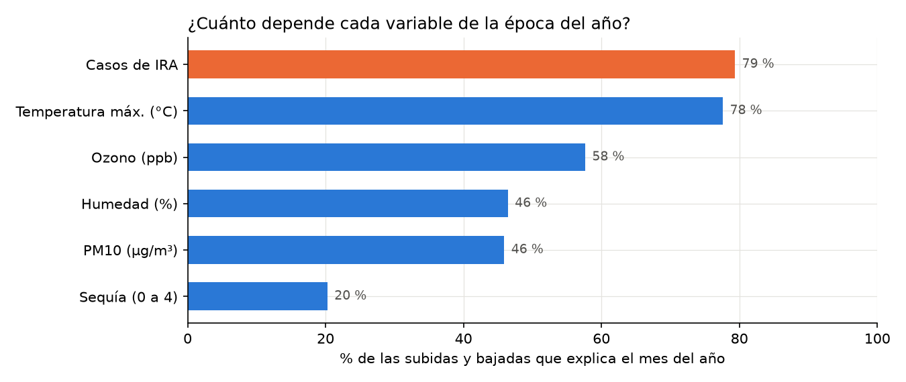

# Reporte Final — Análisis Exploratorio de Datos

---

## 1. Nombre del proyecto

**Análisis Exploratorio y Modelado Espacio-Temporal de la Vulnerabilidad
Socioeconómica y Climática ante Enfermedades Respiratorias en Hermosillo,
Sonora**

---

## 2. Equipo e integrantes

**Equipo:** _[Nombre del equipo — opcional]_

| Integrante | Rol | Correo | LinkedIn / contacto |
|------------|-----|--------|---------------------|
| Ana Patricia Quiroz | Análisis de datos y EDA | _completar_ | _completar_ |
| Luis Hiram Hernandez Gutierrez | Análisis de datos y EDA | _correo_ | _contacto_ |
| Victor Andree De La Torre Velazquez | Análisis de datos y EDA | _correo_ | _contacto_ |

---

## Preguntas de investigación

**Pregunta general:**

> ¿Cómo inciden el calor extremo, la sequía y la contaminación del aire en la
> incidencia de enfermedades respiratorias en Hermosillo?

**Pregunta específica (hipótesis de vulnerabilidad diferencial):**

> ¿Las zonas más marginadas de Hermosillo son las más afectadas por las
> enfermedades respiratorias durante olas de calor y sequía?

Las respuestas del EDA a ambas preguntas están en la sección 5.8.

---

## 3. Resumen de hallazgos

La hipótesis del proyecto era que el calor extremo, la sequía y la
contaminación del aire elevan la incidencia de enfermedades respiratorias en
Hermosillo, y que las zonas más marginadas sufren más. El análisis de 313
semanas (2015–2020) muestra algo distinto: **los casos de infecciones
respiratorias agudas (IRA) siguen un ciclo estacional casi mecánico** — de
~1,900 por semana en julio a ~6,200 en enero — y el mes del año explica por
sí solo el **79 %** de la variación. Las correlaciones que parecían
relacionar clima y casos eran coincidencias de calendario: al comparar cada
semana con lo normal para su mes, la temperatura pasa de −0.78 a −0.02 y el
PM10 de +0.49 a +0.12 (no significativo).

Sobreviven dos señales débiles: semanas **más frías de lo normal** van
seguidas de ~2–3 % más casos en las 3–5 semanas siguientes (−0.15), y el
ozono muestra una asociación frágil (+0.21 que baja a +0.12 sin 2016, año con
lecturas dudosas del sensor). Ninguna señal apunta al calor extremo. La
pregunta de vulnerabilidad diferencial por marginación **no puede
contestarse aún**: la marginación solo existe a nivel municipal; requiere
desagregación por AGEB. Implicación para el producto de datos: evoluciona de
"alerta de calor" a **pronóstico estacional + mapa de vulnerabilidad
urbana**.

> **En una frase:** en cada temporada, cuando baja la temperatura suben los
> casos y viceversa; nos preguntamos si era una relación real con la
> temperatura o un efecto estacional, y resultó ser casi todo estacionalidad —
> lo único que queda es una señal pequeña del frío anómalo 3–5 semanas antes,
> no del calor. Lo que más pesa en los casos de IRA en Hermosillo no es el
> calor extremo ni la contaminación, sino el calendario: los casos casi se
> triplican del verano al invierno todos los años.

---

## 4. Hallazgo más importante (figura representativa)

_Figura 1 — Porcentaje de la variación semanal que se explica solo con saber
el mes del año (promedio histórico 2015–2019 por mes), para cada variable del
panel. Los casos de IRA alcanzan ~79 %: la estacionalidad domina cualquier
relación con el clima o el aire. Fuente: panel integrado semanal
(`data/processed/panel_eda_semanal.parquet`)._

<!-- Alternativa si se prefiere más visual: figures/rel_perfiles_semanal.png
     (casos vs. cada variable a lo largo del año). -->

---

## 5. Detalle de los hallazgos

### 5.1 Datos y cobertura

Se integraron **6 capas** para Hermosillo, 2015–2020: marginación municipal
(CONAPO/INEGI), temperatura (SMN/CONAGUA), calor diario (Open-Meteo), sequía
(Monitor SMN), calidad del aire (RUOA-UNAM, estación ERNO) y casos
confirmados de IRA (SS/DGIS, SINAIS en formato SUIVE). Resultado: panel
mensual de **72 meses × 66 columnas** y panel semanal de **313 semanas × 62
columnas** (semana epidemiológica, domingo a sábado). Limitaciones: los
casos se cuentan por municipio de la **unidad médica** (no de la residencia
del paciente), el 2020 es atípico por la pandemia (~50 % de los casos de un
año normal) y desde 2017 reportan más unidades (consultorios de farmacia),
aunque el total anual se mantiene estable.

### 5.2 Datos faltantes y calidad

Los principales huecos están en calidad del aire: **PM2.5 sin datos válidos
desde jun-2018** (para 2019–2020 se usa PM10 como indicador de partículas) y
**jun–nov 2018 sin ningún contaminante** (estación apagada). Solo se
interpolan huecos cortos (≤ 2 semanas o 1 mes), marcados en `*_interpolado`;
los huecos largos quedan en `NaN`. Los tres diciembres del SMN (2015–2017)
vienen dañados en la fuente. El proceso dejó el panel sin nulos en las
variables de análisis (`3.1-datos-faltantes.ipynb`).

### 5.3 Anomalías (outliers)

Se aplicaron 4 técnicas: IQR, Z-score, comparación contra lo normal de cada
mes, Isolation Forest y Local Outlier Factor. IF y LOF coinciden en **7
semanas raras**; casi todas son eventos reales (episodio de PM10 de
nov-2017, primavera seca de 2018, semanas de 2020 por la pandemia), salvo el
**ozono muy bajo de dic-2016, posible error del sensor**. Decisión del
equipo: no se borra ni corrige ningún dato; las marcas quedan en
`panel_eda_outliers_*.parquet` para repetir análisis sin esas semanas
(`3.2-outliers.ipynb`).

### 5.4 Relaciones entre variables

Muchas "relaciones" son coincidencias de calendario. Ejemplos
(`3.3-relaciones-visualizacion.ipynb`, panel semanal 2015–2019):

- Tal cual, cada grado más de temperatura va con ~195 casos menos; comparando
  semanas del mismo mes, apenas **−5 casos**.
- Las semanas con sequía tienen 17 % menos casos (3,502 vs. 4,219), pero la
  sequía cae en primavera, cuando hay menos casos de todos modos: dentro del
  mes la diferencia es **+0.1 %**.
- **Única señal que pasa la prueba del azar:** después de semanas más frías
  de lo normal para su mes hay ~2–3 % más casos en las semanas siguientes —
  aunque no se repite con la misma fuerza todos los años.

### 5.5 Correlación

Resultados del panel semanal (`3.4-correlacion.ipynb`, 260 semanas):

| Variable | Correlación cruda | Sin la época |
|----------|-------------------|--------------|
| Temperatura | −0.78 | −0.02 (n.s.) |
| PM10 | +0.49 | +0.12 (*p* = 0.18) |
| Ozono (máx. 8 h) | — | +0.21 (*p* = 0.03); **+0.12 sin 2016** |
| Frío anómalo, rezago 5 sem | — | −0.15 (*p* ≈ 0.05) |

Temperatura, humedad y PM10 se repiten entre sí (0.5–0.7): para un modelo
conviene resumirlas en un solo índice.

### 5.6 Estructura multivariada (PCA / t-SNE)

Con las 5 variables de exposición (`3.5-reduccion-dimensionalidad.ipynb`,
225 semanas completas): **2 ejes de PCA guardan el 66 %** de la información
("seco contra húmedo" e "invierno con polvo contra verano caluroso") y las
semanas se agrupan por temporada con PCA y t-SNE; los casos altos caen en el
grupo del invierno — otra vez la estacionalidad. **Sin la época, los grupos
desaparecen** y el eje principal (47 %) no se relaciona con los casos
(−0.12). No existe un "tipo de semana" climática con más casos de lo normal.

### 5.7 Distribución espacial

El análisis por AGEB queda pendiente: la marginación solo existe a nivel
municipal (un solo valor para todo Hermosillo). Como habilitador ya está el
cruce CLUES verificado: las **103 unidades que reportaron IRA** se
localizaron en el catálogo DGIS con coordenadas (90 consulta externa + 13
hospitalización), lo que permitirá georreferenciar a nivel colonia/AGEB con
la cartografía del INEGI.

### 5.8 Conclusiones y trabajo futuro

- **Pregunta general:** con los datos disponibles, el calor extremo, la
  sequía y la contaminación del aire **no muestran asociación** con los
  casos de IRA una vez controlada la estacionalidad. La temporada de
  invierno — y en particular el frío anómalo 3–5 semanas antes — es la
  única señal ambiental consistente, aunque pequeña.
- **Pregunta de vulnerabilidad:** no contestable todavía; requiere datos por
  AGEB.
- **Trabajo futuro:** cartografía AGEB (INEGI) + marginación IMU 2020 para
  mapas coropléticos; GLM con rezagos del frío; índice único
  temperatura/humedad/PM10; tablero de pronóstico estacional para
  planeación en salud pública.
- **Utilidad práctica del resultado nulo:** las correlaciones crudas
  habrían sugerido alertas de calor/PM10 para IRA; el EDA muestra que ese
  esfuerzo estaría mal dirigido y que la planeación debe enfocarse en la
  temporada de invierno.

---

## 6. Bibliografía

- CONAPO. (2020). *Índice de Marginación por Municipio 2015–2020*. Recuperado
  del portal COESPO, Gobierno del Estado de Sonora.
- INEGI. (2020). *Cartografía Geoestadística — AGEB* (pendiente de
  integración).
- SMN/CONAGUA. (s.f.). *Resúmenes mensuales de temperaturas y lluvias* y
  *Monitor de Sequía en México*. https://smn.conagua.gob.mx
- Open-Meteo. (s.f.). *Historical Weather API* (serie diaria Hermosillo,
  1991–2020). https://archive-api.open-meteo.com
- RUOA-UNAM. (s.f.). *Red Universitaria de Observatorios Atmosféricos —
  Observatorio ERNO Hermosillo*. https://ruoa.unam.mx
- Secretaría de Salud / Dirección General de Información en Salud (DGIS).
  (2026). *Casos confirmados de IRA, Sonora 2010–2020 (formato SUIVE)*.
  **Fuente: SS/DGIS, SINAIS (SUIVE), 2010–2020.**
- Secretaría de Salud / DGIS. (2026). *Catálogo de establecimientos de salud
  CLUES*. **Fuente: SS/DGIS, catálogo ESTABLECIMIENTO_SALUD, actualización
  2026-10.**

---

## 7. Repositorio y reproducibilidad

- **Repositorio:** https://github.com/mdc-feature-engineering/sonora-health-climate-eda
- **Libretas:** `notebooks/00_auto_eda/` (auto-EDA), `01_ingesta/` (ETL),
  `02_procesamiento/` (limpieza por capa), `03_eda/` (integración y
  análisis 3.0–3.5).
- **Reporte automático:** `reports/auto_eda_report.html` (ydata-profiling,
  también enlazado en la página del proyecto).
- **Datos:** `data/raw/` (crudos), `data/interim/` (intermedios),
  `data/processed/` (panel integrado).
- **Diccionarios y fuentes:** `references/` (por capa) y
  `references/fuentes.md` (enlaces y fechas de descarga).
- **Reproducción:** `uv venv && uv pip install -r requirements.txt`, luego
  `python -m sonora_health_climate_eda.dataset data-ingestion-pipeline`
  (instrucciones completas en `README.md`).
