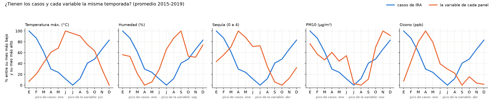
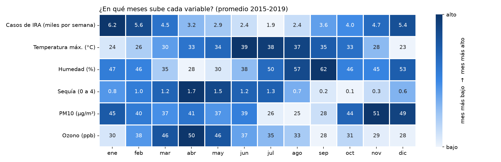
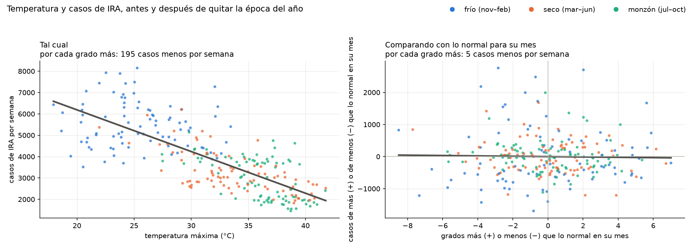
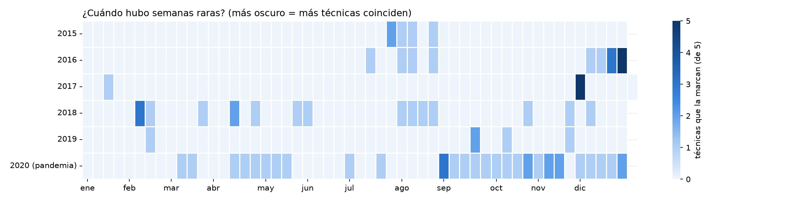
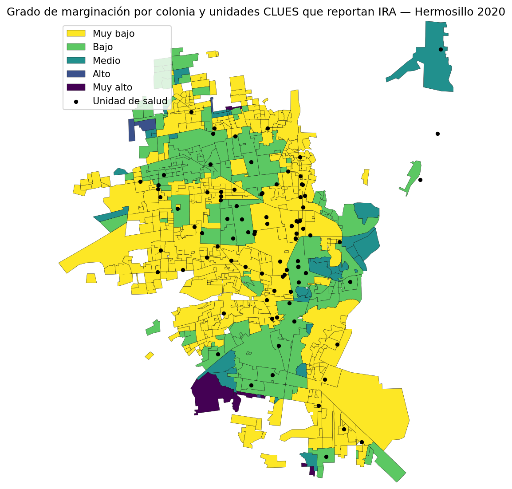

# El impacto de las condiciones ambientales en la salud respiratoria de los hermosillenses

**Integrantes:** Ana Patricia Quiroz Reyes, Luis Hiram Hernández Gutiérrez,
Víctor Andree De La Torre Velázquez

**Repositorio:**
https://github.com/mdc-feature-engineering/sonora-health-climate-eda

---

## 1. Resumen

Partimos de una hipótesis intuitiva: el calor extremo y el aire contaminado
de Hermosillo deberían enfermar a la gente, y las colonias más pobres
sufrirían más. Los datos contaron otra historia. Durante seis años y 313
semanas, las infecciones respiratorias subieron y bajaron siempre al mismo
ritmo: el calendario. El mes del año explica el 79 % de la variación, y al
quitar ese efecto, las aparentes relaciones con el clima desaparecen; solo
persiste una señal débil del frío anómalo, con más casos tres a cinco
semanas después. Ninguna señal apunta al calor extremo.

En cuanto a la vulnerabilidad, las colonias marginadas con datos no
enferman más que las demás ni reaccionan peor al clima. El verdadero
hallazgo fue que las doce colonias más marginadas de Hermosillo ni siquiera
tienen una clínica que las observe: una brecha de acceso a la salud en sí
misma.

---

## 2. Contexto y preguntas de investigación

**Preguntas principales:**

> - ¿Cómo inciden el calor, el frío, la sequía y la calidad del aire en la
>   incidencia de enfermedades respiratorias en Hermosillo?
> - ¿Las zonas más marginadas de Hermosillo son las más afectadas por esas
>   condiciones?

### Hallazgo principal: el calendario manda

Los casos casi se triplican del verano al invierno (~1,900 → ~6,200 por
semana). Todas las variables ambientales también tienen su temporada: el
calor en verano, la sequía en primavera, el ozono en los meses secos. Eso
hace que, tomados tal cual, *todo parezca relacionado con todo*. Al quitar
el efecto del calendario, las correlaciones se desvanecen (temperatura:
−0.78 → −0.02; PM10: +0.49 → +0.12, n.s.): eran solo estacionalidad
compartida. Sobreviven apenas el frío anómalo rezagado (−0.15) y una
asociación frágil del ozono que depende de lecturas dudosas de 2016.

*Figura 1. Cada variable sube en su propio mes.*

*Figura 2. Cada variable sube en su propio mes (casos en enero, temperatura
en junio, ozono en abril, PM10 en noviembre).*

---

## 3. Datos y limitaciones

**Fuentes de información utilizadas (2010–2020):**

| Capa | Fuente | Periodo |
|---|---|---|
| Casos de IRA | Secretaría de Salud / DGIS, SINAIS (SUIVE) | 2010–2020 |
| Clínicas (CLUES) | Secretaría de Salud / DGIS | 2026 |
| Temperatura | SMN/CONAGUA (mensual) + Open-Meteo (diario) | 2015–2020 |
| Sequía | Monitor de Sequía, CONAGUA | 2015–2020 |
| Aire (PM2.5, PM10, O3) | RUOA-UNAM, estación ERNO | 2015–2020 |
| Marginación | CONAPO/INEGI (municipio + colonia) | 2015, 2020 |

**Limitaciones principales:**

Casos registrados por unidad médica y no por residencia; semana de
notificación y no de inicio de síntomas; año 2020 atípico por la pandemia
de COVID-19; incorporación de nuevas unidades desde 2017 (consultorios de
farmacia); huecos en calidad del aire (PM2.5 sin datos válidos desde junio
2018); y marginación municipal empleada como contexto general.

---

## 4. Integración y transformaciones

Se estructuró un **panel semanal de 313 semanas por 62 columnas** y un
panel mensual complementario de 72 meses por 66 columnas para alinear las
seis capas de fuentes distintas.

**¿Por qué panel semanal?** La adopción de una granularidad semanal se
sustenta en tres razones metodológicas: (1) **Nativa de la fuente:**
respeta la periodicidad epidemiológica del SUIVE sin degradar los datos;
(2) **Visibilidad de rezagos:** permite capturar efectos rezagados de 3 a 5
semanas que se diluyen en promedios mensuales; y (3) **Captura de eventos
breves:** preserva la variabilidad de olas de calor, frentes fríos y
episodios de contaminación que el ciclo mensual borra.

**¿Cuáles fueron las transformaciones clave?** *Anomalías:* a cada variable
se le resta su promedio histórico del mes, para comparar enero con enero,
no enero con julio; *interpolación limitada* a huecos de ≤ 2 semanas;
*banderas de calidad* (año atípico, calor extremo con umbral de 38 °C);
*exclusiones documentadas* (PM2.5 por baja cobertura, los 3 diciembres
dañados del SMN 2015–2017).

---

## 5. Análisis de correlación

**El método:** correlación de Spearman entre cada exposición y los casos,
en dos versiones: tal cual vienen los datos y después de quitar la época
(anomalías). La comparación de las dos es el corazón del análisis.

| Variable | Correlación cruda | Sin la época | Lectura |
|---|---|---|---|
| Temperatura | −0.78 | −0.02 | Era solo el calendario |
| PM10 | +0.49 | +0.12 (n.s.) | Ídem |
| Ozono | +0.21 | +0.12 sin 2016 | Frágil: depende de datos dudosos |
| Frío anómalo, rezago 5 sem | n.a. | −0.15 | La única que sobrevive |

**¿Qué significa que "desaparezcan"?** Que la asociación era estacionalidad
compartida: dos cosas que siguen el mismo calendario parecen relacionadas
aunque no se afecten entre sí. Como el consumo de helado y las quemaduras
de sol, que suben juntos en verano.

*Figura 3. La pendiente negativa casi desaparece al comparar solo semanas
del mismo mes: la "relación" temperatura–casos era el calendario, mostrado
con puntos en vez de barras.*

---

## 6. Análisis de distribución, anomalías y PCA

**Distribución asimétrica:** los casos de IRA muestran un comportamiento
estacional y sesgado (semanas típicas de 2,000–4,000 casos frente a picos
invernales > 6,000). Por ello, se emplearon coeficientes de Spearman y
métodos robustos que no asumen normalidad.

**Integridad y datos faltantes:** los vacíos se concentran exclusivamente
en la calidad del aire (PM2.5 y suspensión temporal de la estación en
2018); el resto del panel operativo se mantuvo completo.

**Detección de outliers:** al aplicar cuatro técnicas de detección (IQR,
Z-score, Isolation Forest y LOF), los modelos multivariados coincidieron en
7 semanas críticas correspondientes a eventos reales (episodio de PM10 en
2017, sequía de 2018 y pandemia en 2020), a excepción de una lectura
anómala de ozono en diciembre de 2016 atribuida a un error de sensor. En
consecuencia, no se eliminó ni alteró ningún registro en la base de datos
final.

*Figura 4. Las semanas "raras" no son ruido aleatorio: se agrupan en
eventos reales y, sobre todo, en 2020; argumento extra para tratar ese año
como atípico.*

---

## 7. Análisis por colonia y vulnerabilidad

Se georreferenciaron 103 clínicas (76 dentro de colonias), asignando la
carga de IRA a **58 de las 657 colonias** de Hermosillo sin sesgo de
cobertura (marginación media 0.977 con unidad vs. 0.975 sin unidad); sin
gradiente marginación–carga (ρ = 0.13) ni reacción diferencial al frío
anómalo. La colonia Modelo (sede del HIES) muestra una tasa inflada porque
atiende a toda la ciudad, prueba de que ubicación de clínica ≠ residencia.

*Figura 5. Marginación por colonia (CONAPO 2020) y unidades CLUES (puntos
negros); ninguna cae en las colonias de grado Alto/Muy alto.*

---

## 8. Conclusión

**¿Qué encontramos?** La estacionalidad lo explica casi todo (79 %). Ni el
calor extremo, ni la sequía, ni el aire se asocian con los casos de IRA una
vez quitado el efecto del calendario; solo el frío anómalo deja una señal
débil tres a cinco semanas después.

**¿Las zonas marginadas sufren más?** En las colonias observables, no:
mismo patrón estacional, misma reacción al frío. Pero las 12 más marginadas
no tienen ninguna unidad que las observe: una brecha de acceso en sí
misma.

**¿Qué implica y qué sigue?** Las correlaciones crudas habrían llevado a
alertas de calor y polvo, es decir, un esfuerzo mal dirigido; la planeación
debe enfocarse en el invierno. Siguientes pasos: un modelo con rezagos del
frío, un índice que combine temperatura, humedad y PM10 y un tablero de
pronóstico estacional.

---

## 9. Bibliografía

- CONAPO. (2020). *Índice de Marginación por Municipio 2015–2020*. Portal
  COESPO, Gobierno del Estado de Sonora.
- CONAPO. (2020). *Índice de Marginación Urbana por Colonia*
  (cartografía). datos.gob.mx.
- SMN/CONAGUA. (s.f.). *Resúmenes mensuales de temperaturas y lluvias* y
  *Monitor de Sequía en México*. https://smn.conagua.gob.mx
- Open-Meteo. (s.f.). *Historical Weather API* (serie diaria Hermosillo,
  1991–2020). https://archive-api.open-meteo.com
- RUOA-UNAM. (s.f.). *Red Universitaria de Observatorios Atmosféricos*
  (Observatorio ERNO Hermosillo). https://ruoa.unam.mx
- Secretaría de Salud / Dirección General de Información en Salud (DGIS).
  (2026). *Casos confirmados de IRA, Sonora 2010–2020* (formato SUIVE).
- Secretaría de Salud / DGIS. (2026). *Catálogo de establecimientos de
  salud CLUES*. Catálogo ESTABLECIMIENTO_SALUD.
